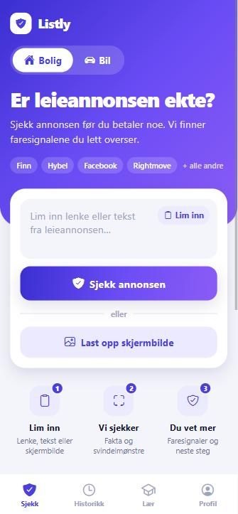
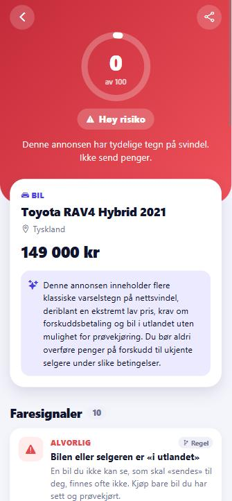
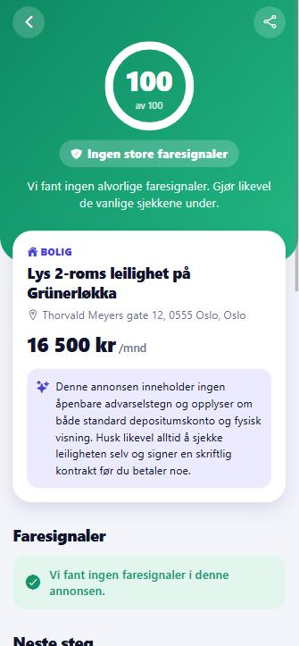
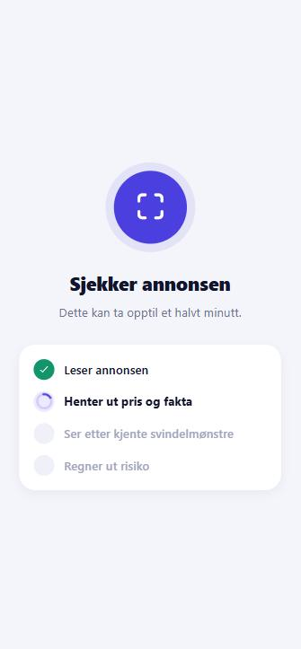
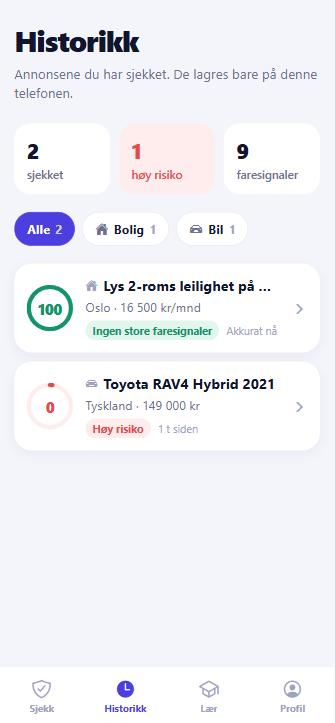
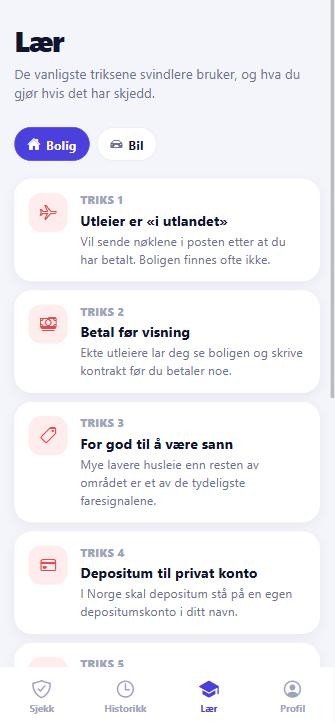

# Listly

**Sjekk en leieannonse eller bruktbilannonse for svindel før du betaler noe.**

Lim inn en lenke, teksten eller et skjermbilde fra Finn, Hybel, Facebook eller hvor som helst. Listly henter ut fakta med AI, kjører egne regler for kjente svindelmønstre og gir deg en risikoscore, faresignaler og konkrete neste steg.

> **English:** Listly is a React Native app that checks rental and used-car listings for scam signals. An AI model extracts structured facts from a pasted link, text or screenshot; a deterministic rule engine catches well-known scam patterns; the app shows a risk score, red flags and next steps. Norwegian UI, prototype stage.

<p align="center">
  
  &nbsp;
  
  &nbsp;
  
</p>

<p align="center">
  
  &nbsp;
  
  &nbsp;
  
</p>

## Funksjoner

- **To kategorier:** bolig og bil, med egne regler, fakta og råd for hver
- **Tre måter å sjekke på:** lim inn lenke, lim inn tekst, eller last opp skjermbilde
- **«Del → Listly»** fra Finn-appen, Safari og andre apper (krever dev build, se under)
- **Risikoscore 0–100** med faresignaler merket som *Regel* eller *AI*
- **Neste steg** tilpasset resultatet, f.eks. depositumskonto (husleieloven), Statens vegvesen og Løsøreregisteret for bil
- **Historikk** med filter og statistikk, lagret lokalt på telefonen
- **Lær-fane** med de vanligste svindeltriksene og hva du gjør hvis du allerede har betalt
- **Lys og mørk modus**

## Teknologi

| Del | Teknologi |
|---|---|
| App | React Native, Expo SDK 57, Expo Router, TypeScript |
| Server | Node.js, Express 5, TypeScript |
| AI | Google Gemini (strukturert JSON-output) |
| Lagring | AsyncStorage (lokalt på enheten) |
| Tester | Node test runner |

## Kom i gang

Krever **Node.js 20+** og en [Gemini API-nøkkel](https://aistudio.google.com/apikey).

**1. Start API-et**

```bash
cd apps/api
npm install
cp .env.example .env   # legg inn GEMINI_API_KEY
npm run dev            # http://localhost:3100
```

**2. Start appen** (i en ny terminal)

```bash
cd apps/mobile
npm install
npm run web            # i nettleseren
```

Eller `npm start` og skann QR-koden med Expo Go på telefonen (telefon og PC må være på samme Wi-Fi). Appen finner API-et automatisk i utvikling. Pek den et annet sted med `EXPO_PUBLIC_API_URL`.

**Tester**

```bash
cd apps/api
npm test
```

### «Del → Listly» krever en dev build

Delemenyen er en native share extension (`expo-share-intent`), så den finnes ikke i Expo Go eller på web. Der er den slått av automatisk, og resten av appen virker som vanlig. For å teste deling på telefon:

```bash
cd apps/mobile
npx expo install expo-dev-client
npx expo run:android   # eller run:ios på Mac
```

## Hvordan det henger sammen

```
Lenke / tekst / skjermbilde / Del-meny
        │
        ▼
apps/mobile  ──POST /api/analyze──▶  apps/api
                                       ├─ fetch-listing.ts  henter én side brukeren delte (SSRF-sikret)
                                       ├─ extract.ts        Gemini: fakta + AI-faresignaler (strukturert JSON)
                                       └─ red-flags.ts      egne regler per kategori + score
        ◀── Analysis { category, facts, flags, score, verdict, summary }
        │
        ▼
Lagres lokalt på telefonen (AsyncStorage)
```

**Brukeren tar med annonsen selv.** Appen henter ikke inn annonser på egen hånd, så den fungerer på alle nettsider uten API-avtaler eller scraping.

**AI og regler sammen.** AI-en er god til å lese annonser, men ikke helt forutsigbar. Derfor kjører faste regler (Western Union, «i utlandet», nøkler i posten, forskudd for å reservere bil …) alltid, uansett hva AI-en svarer. Et alvorlig signal gir alltid «Høy risiko», uansett score.

**Aldri «trygg».** Appen sier aldri at en annonse er ekte, bare hvilke faresignaler den fant.

**Sikkerhet:**
- *SSRF:* lenker brukeren sender inn blir sjekket mot private IP-adresser, også etter omdirigeringer
- *Prompt injection:* AI-en får beskjed om at annonseteksten er data, ikke instruksjoner
- *Rate limiting:* 10 analyser per minutt, siden hver analyse koster et AI-kall

### Kategorier

Kategorien sendes med fra appen (`"rental"` eller `"car"`). Kommer annonsen fra delemenyen uten kategori, gjetter `detectCategory` ut fra lenken (`finn.no/mobility`, `hybel.no` …) og ordene i teksten.

En ny kategori trenger et faktaskjema i `apps/api/src/extract.ts`, regler i `apps/api/src/red-flags.ts` og en oppføring i `apps/mobile/src/categories.ts`.

## Prosjektstruktur

```
apps/
├── api/
│   └── src/
│       ├── index.ts           Express-server og /api/analyze
│       ├── extract.ts         Gemini-kall og faktaskjema per kategori
│       ├── red-flags.ts       regelmotor, kategori-gjetting og score
│       ├── red-flags.test.ts  tester for reglene
│       ├── fetch-listing.ts   henter én annonse (SSRF-sikret)
│       └── types.ts
└── mobile/
    └── src/
        ├── app/
        │   ├── (tabs)/        Sjekk, Historikk, Lær, Profil
        │   ├── analyze.tsx    lasteskjerm
        │   └── analysis/      resultat
        ├── components/
        ├── services/          API-kall og lokal lagring
        ├── categories.ts      tekst, ikoner og tips per kategori
        └── theme.ts           farger for lys og mørk modus
```

## Videre arbeid

- **Innlogging.** API-et er åpent og bare beskyttet med rate limit. Det må på plass før lansering.
- **Oppslag på registreringsnummer** hos Statens vegvesen og **heftelser** i Løsøreregisteret. Nå ber appen brukeren sjekke dette selv.
- **Markedspris-sjekk** mot SSB-statistikk: er prisen mistenkelig lav for området?
- **Omvendt bildesøk** av annonsebildene. Stjålne bilder er det sterkeste svindelsignalet.
- **Sammenligning** av to annonser side om side.
- **Flere kategorier:** ting fra Finn Torget og Marketplace, billetter.
- **Raskere svar.** En analyse tar nå 20–25 sekunder.
- **Ikoner, splash og publisering** til App Store og Google Play.
